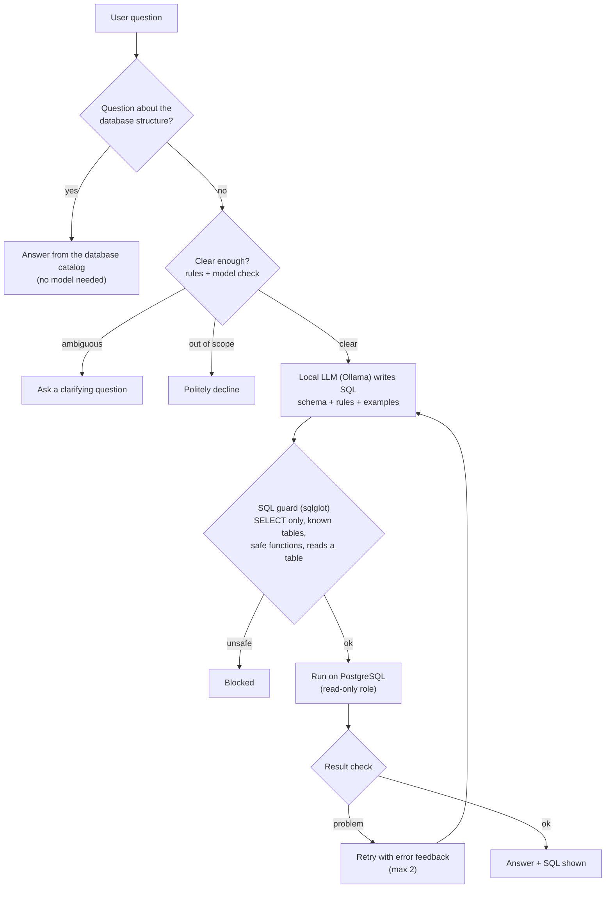

# Offline Text-to-SQL Assistant

Ask questions about a database in plain English and get answers from a **local LLM that runs entirely on your own machine**. No question, schema, or result is sent to an outside service, so it suits data that cannot leave the company, such as legal, medical, or financial records.

## Features

- **Fully offline.** Models run through [Ollama](https://ollama.com); the page uses no CDN scripts or web fonts.
- **Asks when unsure.** Vague questions ("top customers", "recent orders") get a clarifying question with options instead of a guess.
- **Safe by design.** Read-only database role, SQL validated with an AST parser (`sqlglot`), 10-second query timeout.
- **Checks its own answers.** Wrong-shaped or rule-breaking results are sent back to the model with specific feedback (up to 2 retries). If it still cannot get a reliable answer, it says so instead of showing a number it is unsure about.
- **Shows its work.** Every answer includes the SQL that produced it.
- **Measured, not assumed.** A 70-question benchmark with execution-accuracy scoring, run on two model sizes.

## Architecture



## Results

Accuracy is **execution accuracy**: the generated SQL and a hand-written reference query are both run, and the results are compared (row order ignored, extra columns allowed, same number of rows required).

| Model | Test set | Accuracy | First try | Wrong answers | Declined | Avg time / question |
|---|---|---|---|---|---|---|
| qwen2.5-coder 3B | Dev (30) | 93.3% | 93.3% | 0 | 2 | 7.3 s |
| qwen2.5-coder 3B | Held-out (20) | 90.0% | 80.0% | 0 | 2 | 10.5 s |
| qwen2.5-coder 3B | **Final (20)** | **90.0%** | 85.0% | 2 | 0 | 14.3 s |
| qwen2.5-coder 7B | Dev (30) | 100% | 96.7% | 0 | 0 | 28.6 s |
| qwen2.5-coder 7B | Held-out (20) | 95.0% | 90.0% | 1 | 0 | 36.5 s |
| qwen2.5-coder 7B | **Final (20)** | **95.0%** | 95.0% | 1 | 0 | 43.6 s |

*"Wrong answers" ran but returned a wrong result. "Declined" means the system reported that it could not produce a reliable answer. Timings were measured on a laptop with 8 GB of RAM.*

**How the sets were used.** The dev set was used while building and tuning. The held-out set was used to check that the gains generalised. The final set was written after tuning was finished and run once per model; no changes were made afterwards. The final column is the most trustworthy number.

**How the 3B model improved**

| Version | Dev | Held-out |
|---|---|---|
| v1: baseline prompt | 86.7% | 80.0% |
| v2: join paths, business rules, more examples | 93.3% | 80.0% |
| v3: + result checks and retry loop | 93.3% | 90.0% |

**Findings**
- Prompt tuning raised the dev score but did **not** carry over to the held-out set (v2). Code-level result checks did (v3), because small models often ignore long lists of prompt rules.
- The retry loop only pays off when the checks give it something specific to fix: held-out first-try accuracy was 80% and final accuracy 90%.
- The 7B model needed fewer retries and handled the hardest questions better, at roughly 3 times the latency on this hardware. The gap on the final set is one question out of 20, so it is suggestive, not conclusive.

## How it works

1. **Structure questions** ("how many columns?", "what tables are there?") are answered by fixed queries against the database catalog, with no model involved.
2. **Clarity check.** Rules catch vague ranking words, vague time words, and topics the data does not contain (for example profit, when there is no cost data). A model check handles the rest.
3. **SQL generation.** The prompt contains the live schema (read from PostgreSQL, including allowed values of short text columns), join paths, business rules (for example, "revenue means paid payments"), and worked examples.
4. **Guard.** The SQL is parsed, not pattern-matched. It must be one `SELECT` statement, use only known tables, call no dangerous functions (such as `pg_sleep`), and read from at least one table.
5. **Execution.** Runs under a read-only role, in a read-only session, with a statement timeout.
6. **Result check.** A "how many" question must return exactly one row; revenue must only count paid payments. Problems go back to the model with a specific message.
7. **Logging.** Each question, its SQL, status, attempts, and time are appended to `logs/queries.jsonl`. Result rows are never logged.

## Privacy and security

- The model sees only the question, the schema (table and column names, plus allowed values for short text columns), and error messages. It never receives result rows.
- If you point this at a model hosted outside your machine, the schema values would leave the machine as well, so review that first.
- Database access uses a separate read-only role. The sample password in `database/readonly_user.sql` is a placeholder: change it for any real use.
- The SQL guard is an additional layer, not a replacement for proper database permissions.

## Setup

**Requirements:** Python 3.10+, PostgreSQL, [Ollama](https://ollama.com/download)

```bash
# 1. Get the code and install packages
git clone https://github.com/[your-username]/[repo-name].git
cd [repo-name]
python -m venv venv
venv\Scripts\activate          # macOS/Linux: source venv/bin/activate
pip install -r requirements.txt

# 2. Settings
copy .env.example .env         # macOS/Linux: cp .env.example .env
# then edit .env and set DB_PASSWORD to your PostgreSQL password

# 3. Create and fill the sample database (200 customers, 48 products, 1,500 orders)
psql -U postgres -c "CREATE DATABASE shop_db;"
psql -U postgres -d shop_db -f database/schema.sql
python database/seed.py
psql -U postgres -d shop_db -f database/readonly_user.sql

# 4. Download a model (once, needs internet; after this everything runs offline)
ollama pull qwen2.5-coder:3b

# 5. Run
uvicorn server:app --port 8000
```

Open http://127.0.0.1:8000. The first question after starting is slow because the model has to load into memory.

A terminal version is also available: `python chat.py`.

**Configuration (`.env`)**

| Variable | Meaning |
|---|---|
| `OLLAMA_MODEL` | Model used for answers, for example `qwen2.5-coder:3b` or `qwen2.5-coder:7b` |
| `USE_LLM_TRIAGE` | `true` adds a model-based clarity check (a few extra seconds per question) |

## Run the evaluation

```bash
python evaluate.py --set dev
python evaluate.py --set heldout
python evaluate.py --set final --model qwen2.5-coder:7b
python compare_models.py       # prints a table of all saved runs
```

Results are saved to `evaluation/results/`.

## Project structure

```
├── app/
│   ├── config.py       settings
│   ├── db.py           read-only connection, schema reader
│   ├── prompt.py       join paths, business rules, examples
│   ├── generator.py    calls the local model, fixes failed SQL
│   ├── guard.py        SQL validation (sqlglot)
│   ├── checks.py       result sanity checks
│   ├── clarify.py      rules + model check for unclear questions
│   ├── metadata.py     answers table/column questions from the catalog
│   └── pipeline.py     ties everything together
├── database/           schema, seed script, read-only role
├── evaluation/         test sets and saved results
├── static/index.html   chat interface (no external resources)
├── server.py           FastAPI backend
├── chat.py             terminal chat
├── evaluate.py         benchmark runner
└── compare_models.py   results table
```

## Issues found during testing

Using the system as a real user found problems that the benchmark missed. Each led to a fix:

1. **A "how many" question returned one row per customer** instead of one number. Added result-shape checks and retry feedback.
2. **A reply that was not SQL crashed the guard** (an unhandled tokenizer error). Now treated as invalid SQL, and the server has a catch-all safety net.
3. **A made-up answer passed the guard.** "Tell me a joke" produced a `SELECT` of a typed-in text value, which is valid SQL. The guard now requires a query to read at least one table.
4. **Questions about the database structure were blocked**, because the model's query touched the system catalog. They are now answered by fixed queries instead of the model.
5. **Overfitting to the dev set.** Prompt gains did not transfer to unseen questions, which is why a held-out set and a final set exist.

## Limitations and future work

- Test sets are small (20 to 30 questions each), use one synthetic database, and the reference answers were written by the author. Some held-out failures were seen before the result checks were written, which is why the final set exists.
- Result checks cover only some mistakes. Known gaps in the final run: counting after a join can double-count (7B), "most expensive" style questions are not forced to return one row (3B), and "both A and B" can be confused with "A or B" (3B).
- Join paths and business rules are written by hand for this database. A new database needs `app/prompt.py` adapted.
- Latency is high on a laptop with 8 GB of RAM, especially with the 7B model. A machine with more memory or a GPU would be much faster.
- Requests are answered one at a time, and there is no user login.

## Built by

[Shubhangi Ingle] 